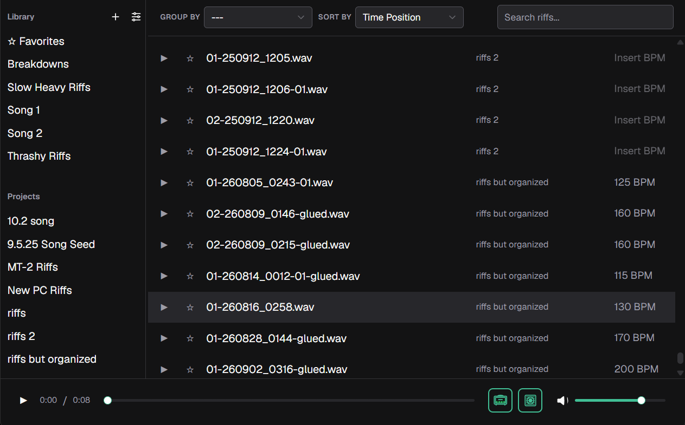

# Riff Organizer

Riff Organizer is a tool for guitarists and songwriters who use REAPER. It makes it easy to explore riffs across your projects, rediscover old ideas, and group riffs together into finished songs.

## How It Works

Riff Organizer scans your REAPER projects, letting you browse riffs and organize them into groups without having to open each project individually. Riffs can be grouped by BPM, making it easier to find riffs at similar tempos and discover ideas that work well together.

With integrated [Neural Amp Modeler (NAM)](https://www.neuralampmodeler.com/) support and impulse response loading, you can preview riffs with your preferred tones. The installer optionally includes three NAM models: Clean, Crunch, and High Gain - along with a cabinet IR. You can also use your own models downloaded from [TONE3000](https://www.tone3000.com/) or other sources.

## Download

Riff Organizer is currently available for **Windows**.

Download the latest release from the [Releases](../../releases) page and run the installer.
